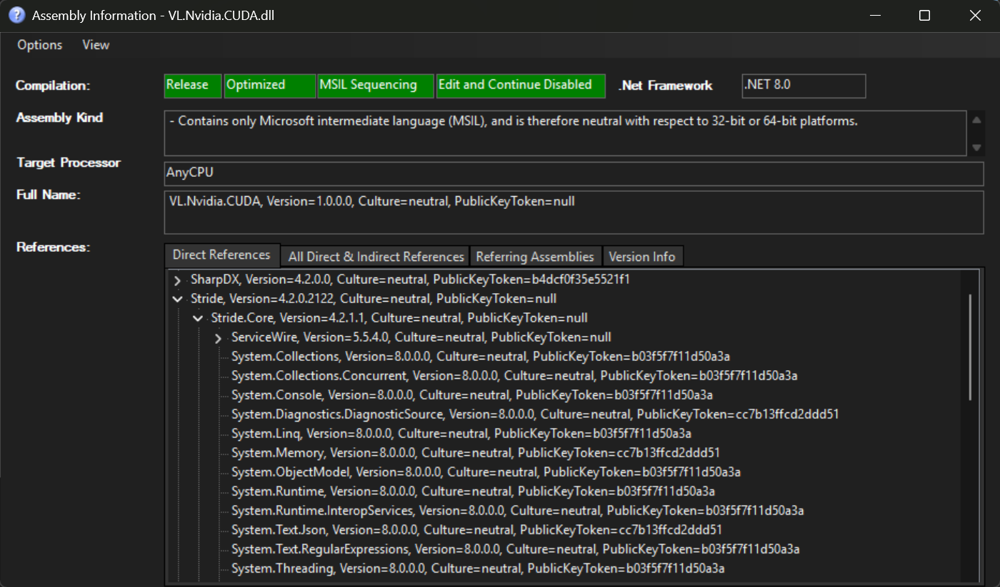

# Dev.to Blog Post

**Tags**: #dotnet #csharp #windows #developer-tools #opensource
**Cover Image**: Screenshot of the tool UI
**Canonical URL**: (optional - if you post on tebjan.de first)

---

## Title
Quick .NET Assembly Inspection Right from Windows Explorer

---

## Article Body

## TL;DR

I modernized a classic .NET tool that adds "Assembly Information" to Windows Explorer's context menu. Right-click any DLL/EXE to see Debug/Release mode, target framework, dependencies, and more - without opening ILSpy.

**Download**: [GitHub Releases](https://github.com/tebjan/AssemblyInformation/releases)
**Source**: [github.com/tebjan/AssemblyInformation](https://github.com/tebjan/AssemblyInformation)

---

## The Problem

As a .NET developer, I constantly need to answer simple questions about assemblies:
- Is this DLL Debug or Release?
- What .NET version does it target?
- What are its dependencies?

My usual workflow? Open ILSpy, load the assembly, navigate to the metadata. For such simple questions, that's overkill.

---

## The Solution


Windows Explorer context menu integration. Right-click → "Assembly Information" → instant metadata.



### What It Shows

1. **Compilation Mode** - Debug or Release (via `DebuggableAttribute`)
2. **Assembly Identity** - Full name with version, culture, public key token
3. **Framework Target** - .NET Framework 4.8? .NET 8? .NET Standard 2.1?
4. **PE Characteristics** - x86, x64, AnyCPU, ARM, CorFlags
5. **Dependencies** - Full recursive dependency tree
6. **Quick Navigation** - Double-click any reference to inspect it

---

## Technical Implementation

### MetadataLoadContext FTW

The key to safe assembly inspection is **not loading assemblies into the runtime**:

```csharp
// The safe way - inspection without execution
var resolver = new PathAssemblyResolver(searchPaths);
using var context = new MetadataLoadContext(resolver);
var assembly = context.LoadFromAssemblyPath(filePath);

// Now you can safely read metadata
var debugAttribute = assembly.GetCustomAttributesData()
    .FirstOrDefault(a => a.AttributeType.Name == "DebuggableAttribute");
```

**Why MetadataLoadContext?**
- ✅ No code execution - safe for untrusted assemblies
- ✅ Works with any .NET version - inspect old Framework 2.0 DLLs on .NET 8
- ✅ No file locks - assemblies remain accessible
- ✅ Cross-version inspection - .NET 8 app can inspect .NET Framework assemblies

**Old approach (DO NOT USE):**
```csharp
// ❌ Assembly.Load - executes static constructors, locks files
var assembly = Assembly.Load(assemblyName);

// ❌ Assembly.ReflectionOnlyLoad - deprecated, limited
var assembly = Assembly.ReflectionOnlyLoad(assemblyName);
```

### Windows Shell Extension

The context menu integration is a C++ ATL/COM shell extension (`IContextMenu` interface). When you right-click a file, Windows queries registered shell extensions, and ours adds the "Assembly Information" menu item for `.dll` and `.exe` files.

---

## Cross-.NET Version Support

Works seamlessly across:
- .NET Framework 2.0 - 4.8
- .NET Core 1.0 - 3.1
- .NET 5, 6, 7, 8, 9+
- .NET Standard 1.0 - 2.1

The secret? `PathAssemblyResolver` with multiple search paths:
```csharp
var paths = new List<string>
{
    targetDirectory,
    RuntimeEnvironment.GetRuntimeDirectory(), // Current .NET runtime
    GetReferenceAssembliesPath() // .NET Framework reference assemblies
};
```

---

## Project History

This tool has a rich lineage:

**2008** - Created by **rockrotem** on CodePlex
**2011-2012** - Major enhancements by **Ashutosh Bhawasinka** (recursive dependencies, shell extension)
**2014** - Migrated to GitHub by **Jozef Izso** when CodePlex sunset was announced
**2025-2026** - Modernized to .NET 8 with `MetadataLoadContext` by me ([Tebjan Halm](https://tebjan.de))

Standing on the shoulders of giants.

---

## Use Cases

### 1. Build Verification
Quick check if your Release build actually compiled in Release mode:
```
Right-click MyApp.dll → Assembly Information
✅ Compilation: Release
```

### 2. Dependency Auditing
See all transitive dependencies at a glance. Found a vulnerability in `Newtonsoft.Json 10.0.0`? Quickly check if your DLLs reference it.

### 3. Framework Targeting
"Does this library support .NET Standard 2.0?" Right-click and find out.

### 4. Reverse Engineering
Before firing up dnSpy for full decompilation, get a quick metadata overview.

---

## Installation

1. Download the [latest release](https://github.com/tebjan/AssemblyInformation/releases)
2. Extract `AssemblyInformation.exe`
3. Run it directly: `AssemblyInformation.exe path\to\assembly.dll`
4. (Optional) Register the shell extension for context menu integration

**Requirements:** .NET 8 Runtime (download from [dotnet.microsoft.com](https://dotnet.microsoft.com))

---

## Open Source

Licensed under **Microsoft Public License (Ms-PL)** - free and open source!

Contributions welcome:
- Bug reports
- Feature requests
- Pull requests
- GitHub stars appreciated

**Repo:** [github.com/tebjan/AssemblyInformation](https://github.com/tebjan/AssemblyInformation)

---

## Conclusion

Simple tools that integrate into your workflow are often the most useful. No need to context-switch to another app - just right-click and get the info you need.

If you work with .NET assemblies on Windows, give it a try!

---

**About me:** I'm [Tebjan Halm](https://tebjan.de), a real-time AI engineer and graphics programmer. I work on projects at the intersection of AI, GPU programming, and creative coding. You can find me on [GitHub](https://github.com/tebjan), [X/Twitter](https://x.com/tebjan), and [LinkedIn](https://linkedin.com/in/tebjan).

---

## Discussion

What's your workflow for inspecting .NET assemblies? Do you use ILSpy, dnSpy, JetBrains dotPeek, or something else? Let me know in the comments!
