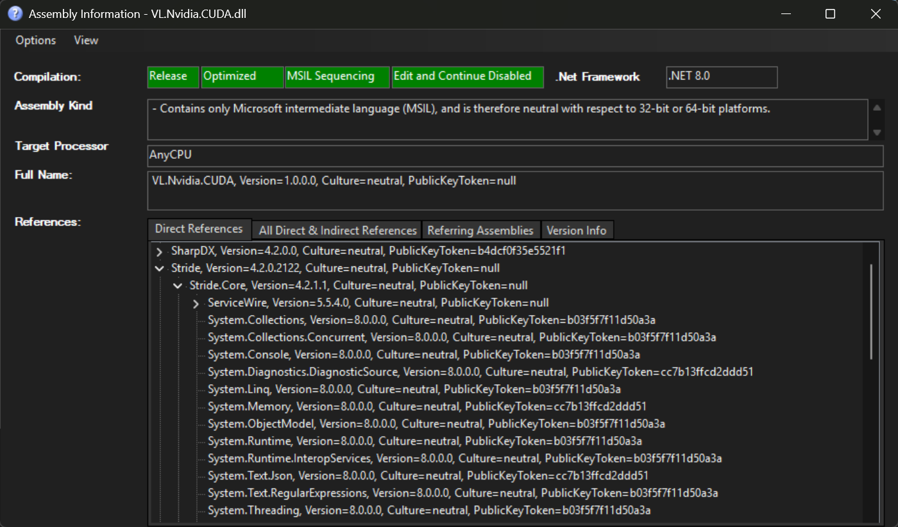

# Reddit r/csharp Announcement

**Subreddit**: r/csharp (220k+ members)
**Post Type**: Link post to GitHub repo
**Flair**: Made a thing

---

## Title
[Tool] Windows Explorer extension for inspecting .NET assemblies (Debug/Release, dependencies, framework version)

---

## Post Body

Ever needed to quickly check if a DLL is Debug or Release? Or see what framework version it targets? I got tired of opening ILSpy for simple metadata checks, so I modernized a classic CodePlex tool.

**Quick demo:**
Right-click any .NET assembly → "Assembly Information"

**What you get:**
1. **Compilation mode** - Debug vs Release (DebuggableAttribute check)
2. **Assembly identity** - Full name with version/culture/token
3. **Framework target** - .NET Framework 4.8? .NET 8? .NET Standard 2.0? It shows all
4. **PE characteristics** - x86/x64/AnyCPU/ARM, CorFlags, preferred 32-bit
5. **Dependency graph** - Full recursive tree of all references
6. **Quick navigation** - Double-click any reference to inspect it

**Why C# devs will love it:**
- No more `dotnet --info` gymnastics
- No more ILSpy/dnSpy for simple metadata
- See transitive dependencies instantly
- Works on ANY .NET version (even old Framework 2.0 assemblies)

**Technical implementation:**
```csharp
// Uses MetadataLoadContext - inspection without loading
var resolver = new PathAssemblyResolver(paths);
using var mlc = new MetadataLoadContext(resolver);
var assembly = mlc.LoadFromAssemblyPath(path);
// Safe to inspect any assembly without executing code
```

**Download & Source:**
- Releases: https://github.com/tebjan/AssemblyInformation/releases
- GitHub: https://github.com/tebjan/AssemblyInformation
- License: Ms-PL (open source)

**Project history:**
Originally created by rockrotem (2008) and enhanced by Ashutosh Bhawasinka (2011-2012) on CodePlex. I've modernized it to .NET 8 with MetadataLoadContext for safer assembly inspection.



Questions? Suggestions? Let me know!

---

## Engagement Tips
- Technical audience - be ready to discuss MetadataLoadContext vs Assembly.ReflectionOnlyLoad
- Share code snippets if asked about implementation
- Mention vvvv (visual programming) if asked about your background
- Post on weekdays, morning EST
