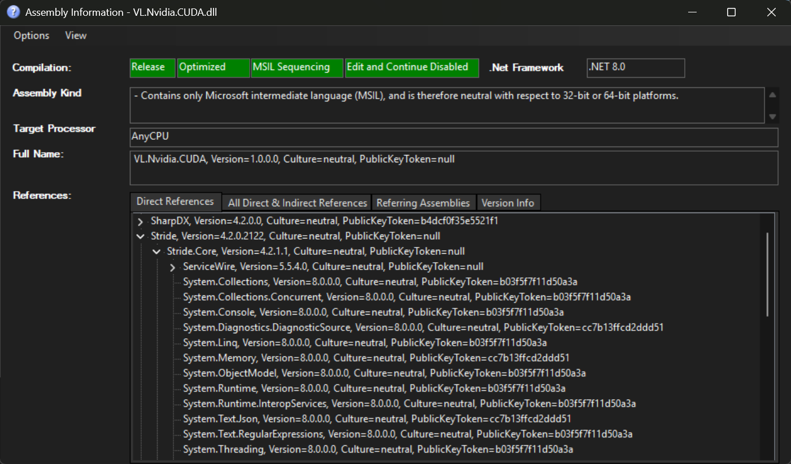

# Reddit r/dotnet Announcement

**Subreddit**: r/dotnet (140k+ members)
**Post Type**: Link post to GitHub repo
**Flair**: Project

---

## Title
.NET Assembly Inspector - Windows Explorer context menu extension for quick assembly metadata inspection

---

## Post Body

I updated an old tool from CodePlex (originally by rockrotem and Ashutosh Bhawasinka, 2008) that I use regularly.

**What it does:**
Right-click any .NET DLL/EXE in Windows Explorer → "Assembly Information"

Shows you:
- Debug vs Release build (checks DebuggableAttribute)
- Full assembly name with version/culture/token
- Target framework (.NET Framework, Core, 5-8+, Standard)
- PE architecture (x86, x64, AnyCPU, ARM)
- All dependencies (recursive tree)
- Double-click any reference to inspect it

**Why:**
Got tired of opening ILSpy just to check if something is Debug or Release, or what .NET version it targets. Two clicks instead.

**How it works:**
Uses `MetadataLoadContext` instead of loading assemblies into the runtime, so it's safe and works with any .NET version (even ancient Framework 2.0 stuff).

**Link:** https://github.com/tebjan/AssemblyInformation

Ms-PL license. Original tool by rockrotem & Ashutosh Bhawasinka (2008-2012), migrated from CodePlex by Jozef Izso (2014).

Helpful when you're stuck in DLL hell.

---

## Engagement Tips
- Respond to comments within first hour
- Share specific use cases if asked
- Be ready to discuss technical implementation (MetadataLoadContext vs Assembly.Load)
- Post during US business hours (EST morning) for maximum visibility
